```kotlin
object Yana : AndroidDeveloper(level = Level.Junior) {
    val speaks     = "Kotlin"
    val paintsWith = "Jetpack Compose · Material 3"
    val thinksIn   = "Clean Architecture + MVVM"
    val worksWith  = listOf(
        "Hilt", "Room", "Retrofit", "Coroutines & Flow",
        "DataStore", "WorkManager", "Coil", "Navigation Compose",
    )
    val nextUp     = "unit tests for ViewModels and use cases"
}
```

### ✦ Things I've built

<a href="https://github.com/yana-chernaya/Lumie"></a>

<p><a href="https://github.com/yana-chernaya/News"></a><a href="https://github.com/yana-chernaya/Notes"></a></p>

<p align="center"><sub>made with Kotlin</sub></p>
